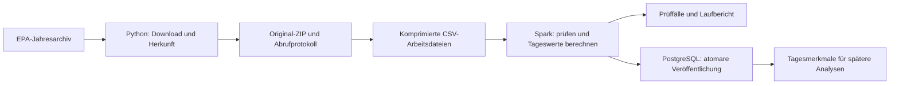

# Architektur und Entscheidungen

## Ablauf

Die Dienste sind bewusst klein gehalten. Eine zusätzliche Nachrichtenwarteschlange oder ein dauerhaft laufender Orchestrierungsdienst ist für die quartalsweise Verarbeitung einer Jahresdatei nicht erforderlich. Die Reihenfolge ist durch das Startskript und einen erfolgreichen Exit-Code festgelegt.

## Python und Spark

Python übernimmt Netzwerkzugriff, Archivprüfung, Protokolle und Datenbanksteuerung. Spark übernimmt die Verarbeitung der stündlichen Beobachtungen. Die Eingabespalten werden ausdrücklich als Strings definiert und anschließend kontrolliert konvertiert. Es gibt keine von Stichproben abhängige automatische Schemaerkennung und keine Python-UDF im Transformationspfad.

Das ZIP enthält eine einzelne große CSV. Sie wird beim Arbeitslauf in gzip-Dateien zu jeweils höchstens 100.000 Beobachtungen aufgeteilt. So können mehrere Spark-Aufgaben gleichzeitig lesen, ohne zusätzlich die gesamte unkomprimierte Datei auf dem Host abzulegen. Es entstehen neue Arbeitsdateien, die unveränderte Originalquelle bleibt daneben erhalten. Nach Abschluss oder behandeltem Fehler werden die Arbeitsdateien entfernt.

Der lokale Spark-Prozess verwendet vier Threads. Auf dieser Datenmenge wäre auch eine schlankere Lösung denkbar. Spark bietet einen nachvollziehbaren Weg zu verteilter Verarbeitung, verursacht lokal jedoch JVM-, Shuffle- und Speicheraufwand. Die aktuelle Veröffentlichung über einen einzelnen PostgreSQL-Schreiber und die serielle ZIP-Aufteilung begrenzen die Skalierung. Clusterbetrieb wäre eine eigene Weiterentwicklung und wird nicht als bereits nachgewiesen dargestellt.

## Veröffentlichung und Wiederanlauf

Für jede Jahrespartition wird vor der Verarbeitung ein PostgreSQL-Advisory-Lock gehalten. Ein zweiter Schreiber derselben Partition wird abgewiesen. Bei Prozessende löst PostgreSQL den Lock.

Die Tagesdateien werden zunächst in eine temporäre Tabelle kopiert. Constraints und Zeilenzahl werden geprüft. Danach werden innerhalb **einer Transaktion** die bisherigen Ergebnisse derselben Partition ersetzt, die aktive Version gesetzt und der Lauf als erfolgreich markiert. Ein Fehler zwischen Löschen und Einfügen führt zum Rollback. Leser sehen damit weiterhin den bisherigen abgeschlossenen Stand.

Eine wiederholte Ausführung überspringt die Berechnung nur dann, wenn Quellhash, Rechenrezept und der erneut aus PostgreSQL gelesene Ergebnishash übereinstimmen. Das Rezept berücksichtigt Programmdateien, Regeln, Schema, Dockerfile, Abhängigkeiten sowie Python- und Spark-Version. Fehlende oder veränderte Ergebniszeilen erzwingen eine neue Verarbeitung.

## Speicherung und Zugriff

Rohdaten und Verarbeitungsauszüge liegen in einem lokalen Bind-Mount. Die Datenbank liegt in einem benannten Docker-Volume. Im Repository liegen Code und kleine, überprüfbare Nachweise, keine großen Jahresdateien oder Universitätsunterlagen.

Der Pipeline-Datenbanknutzer ist kein Superuser und darf keine Rollen oder Datenbanken anlegen. Der administrative Nutzer hat ein eigenes Passwort. Der Datenbankport wird nicht am Host veröffentlicht. Die Quelle enthält öffentlich zugängliche Umweltmessungen und Standortkoordinaten, keine hier verarbeiteten personenbezogenen Datensätze. Passwörter und Laufverzeichnisse sind von Git ausgeschlossen.

## Verhältnis zu Phase 1

Datenquelle, Batch-Ansatz, Python, Spark, PostgreSQL und Compose bleiben wie eingereicht. Präzisiert wurden die Qualitätsregeln, die Definition einer Messreihe, die Behandlung lokaler Zeit und der tatsächliche Wiederanlauf. Die Aufteilung in komprimierte Arbeitsdateien ist eine technische Anpassung an den gemessenen Speicherbedarf.
