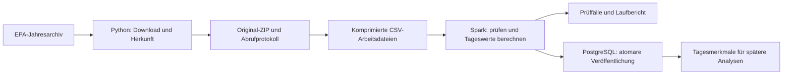

# Architektur und Entscheidungen

## Ablauf

Das Startskript führt Datenaufnahme und Verarbeitung nacheinander aus. Jeder Schritt muss erfolgreich enden, bevor der nächste startet. Für die vorgesehene quartalsweise Verarbeitung ist kein dauerhaft laufender Orchestrierungsdienst eingerichtet.

## Python und Spark

Python übernimmt Download, Archivprüfung, Protokolle und Datenbanksteuerung. Spark verarbeitet die stündlichen Beobachtungen. Die Eingabespalten werden als Strings eingelesen und anschließend mit expliziten Typ- und Formatprüfungen konvertiert. Die Transformation verwendet die eingebauten Spark-Funktionen.

Das ZIP enthält eine einzelne große CSV. Sie wird beim Arbeitslauf in gzip-Dateien zu jeweils höchstens 100.000 Beobachtungen aufgeteilt. So können mehrere Spark-Aufgaben gleichzeitig lesen, ohne zusätzlich die gesamte unkomprimierte Datei auf dem Host abzulegen. Es entstehen neue Arbeitsdateien, die unveränderte Originalquelle bleibt daneben erhalten. Nach Abschluss oder behandeltem Fehler werden die Arbeitsdateien entfernt.

Spark verwendet lokal vier Threads. Für diese Datenmenge wäre auch eine kleinere Lösung möglich. Spark unterstützt verteilte Verarbeitung, bringt lokal aber zusätzlichen Betriebsaufwand mit sich. Die serielle ZIP-Aufteilung und der einzelne PostgreSQL-Schreiber begrenzen die Skalierung. Ein Clusterbetrieb müsste diese beiden Schritte berücksichtigen und separat getestet werden.

## Veröffentlichung und Wiederanlauf

Für jede Jahrespartition wird vor der Verarbeitung ein PostgreSQL-Advisory-Lock gehalten. Ein zweiter Schreiber derselben Partition wird abgewiesen. Bei Prozessende löst PostgreSQL den Lock.

Die Tagesdateien werden zunächst in eine temporäre Tabelle kopiert. Constraints und Zeilenzahl werden geprüft. Danach werden innerhalb **einer Transaktion** die bisherigen Ergebnisse derselben Partition ersetzt, die aktive Version gesetzt und der Lauf als erfolgreich markiert. Ein Fehler zwischen Löschen und Einfügen führt zum Rollback. Leser sehen damit weiterhin den bisherigen abgeschlossenen Stand.

Eine wiederholte Ausführung überspringt die Berechnung nur dann, wenn Quellhash, Rechenrezept und der erneut aus PostgreSQL gelesene Ergebnishash übereinstimmen. Das Rezept berücksichtigt Programmdateien, Regeln, Schema, Dockerfile, Abhängigkeiten sowie Python- und Spark-Version. Fehlende oder veränderte Ergebniszeilen erzwingen eine neue Verarbeitung.

## Speicherung und Zugriff

Rohdaten und Verarbeitungsauszüge liegen in einem lokalen Bind-Mount, die Datenbank in einem benannten Docker-Volume. Das Repository enthält Code, Konfiguration, Dokumentation und Prüfergebnisse. Die Quelldateien werden beim Einrichten heruntergeladen.

Der Pipeline-Datenbanknutzer ist kein Superuser und darf keine Rollen oder Datenbanken anlegen. Der administrative Nutzer hat ein eigenes Passwort. Der Datenbankport wird nicht am Host veröffentlicht. Die Quelle enthält öffentlich zugängliche Umweltmessungen und Standortkoordinaten, keine hier verarbeiteten personenbezogenen Datensätze. Passwörter und Laufverzeichnisse sind von Git ausgeschlossen.

## Verhältnis zu Phase 1

Datenquelle, Batch-Ansatz, Python, Spark, PostgreSQL und Compose bleiben wie eingereicht. Präzisiert wurden die Qualitätsregeln, die Definition einer Messreihe, die Behandlung lokaler Zeit und der tatsächliche Wiederanlauf. Die Aufteilung in Arbeitsdateien ermöglicht das parallele Einlesen des Jahresarchivs.
